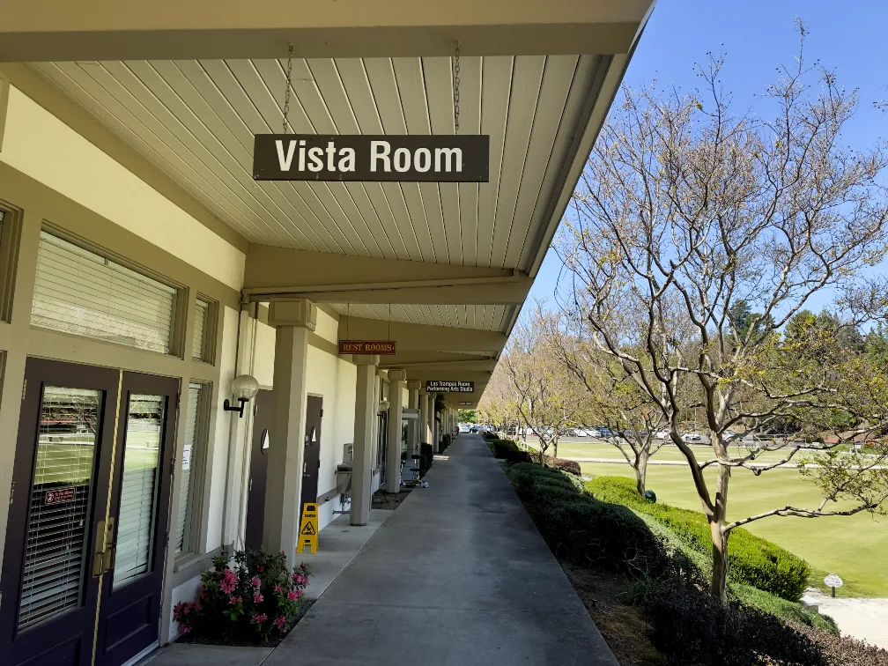

<section class="page-head">
    

        
Come to a program

        <h1>Visit us</h1>
        
We meet once a month, on the second Friday, in the Vista Room at the Hillside Complex. You don't need to be a member or know anyone &mdash; just come. The program starts at 11:30.

    

</section>

<section class="block">
    

        

            

                

                    <h2>When &amp; where</h2>
                    
Second Friday of the month

                    
Doors open at 11:15 am. The program begins at 11:30 am.

                    
<strong>Vista Room</strong> 
                       Hillside Complex 
                       3400 Golden Rain Road 
                       Walnut Creek, CA 94595

                    

                        <a class="btn btn-teal" href="https://www.google.com/maps/dir/?api=1&amp;destination=3400+Golden+Rain+Road,+Walnut+Creek,+CA+94595" target="_blank" rel="noopener">Open in Maps</a>
                    

                

            

            

                <h2>Getting through the gate</h2>
                
Rossmoor is a gated community. If you live in Rossmoor, you're already in &mdash; just come to the Vista Room. If you're coming from outside, the gate is easy once you know how it works:

                <ol class="visit-steps">
                    <li><strong>Let us know you're coming.</strong> Email <a href="mailto:info@rossmooruu.org?subject=Visiting a program">info@rossmooruu.org</a> a few days ahead and we'll let the gate know to expect you.</li>
                    <li><strong>Take the visitor lane.</strong> At the gate, use the visitor lane on the left. The lanes on the right are for residents' cars.</li>
                    <li><strong>Have your driver's licence ready.</strong> Security may ask to see it, and they'll ask who you're visiting. Say you're attending the Rossmoor UU program in the Vista Room.</li>
                </ol>
                

                    
If the guard can't find your name, ask them to call the club contact &mdash; we'll vouch for you. Don't turn around at the gate; a phone call sorts it out.

                

            

        

    

</section>

<section class="block band">
    

        

            

                <h2>Once you're inside</h2>
                
Set your GPS to 3400 Golden Rain Road, Walnut Creek, and follow the signs to the Hillside Complex. Park in the main Hillside lot &mdash; there's plenty of it, and the clubhouse entrance is a short, level walk from the car.

                
The Vista Room is on the ground floor. Look for the Rossmoor UU sign at the door, or ask anyone at the clubhouse.

            

            

                
            

        

    

</section>

<section class="block">
    

        <h2>What to expect</h2>
        

            

                <h3>A different program each month</h3>
                
A speaker, a film, or a discussion &mdash; something to think about. Recent programs have covered organ donation, censorship and free expression, and the landscape of Rossmoor itself.

            

            

                <h3>A brown-bag lunch</h3>
                
Bring your own lunch or just come for the program. People eat and talk before and after.

            

            

                <h3>No charge, no pressure</h3>
                
Free and open to Rossmoor residents and their guests. No reservation needed for the program itself.

            

        

        
<a href="/past_programs">See what past programs looked like &rarr;</a>

    

</section>
